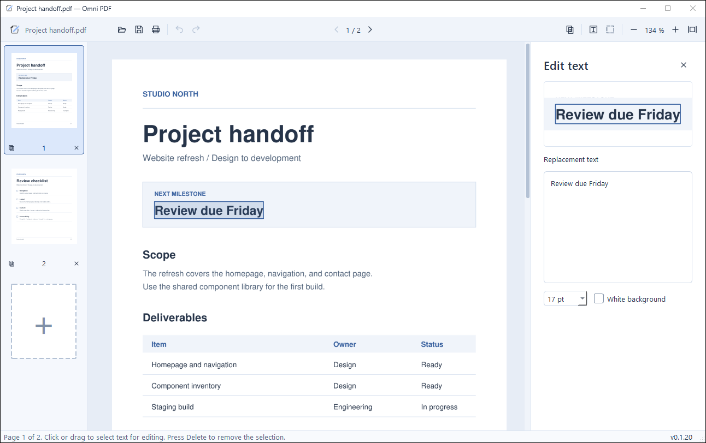

  <picture>
    <source media="(prefers-color-scheme: dark)" srcset="omnipdf/assets/omni.svg">
    
  </picture>
  <h1>Omni PDF</h1>
  
<strong>Edit PDFs simply, right on Windows.</strong>

  
No account · Local processing

  

    
    
    
  

  
<strong><a href="https://github.com/hudakjakub/OmniPDF/releases/latest">Download for Windows ↓</a></strong> &nbsp; · &nbsp; <a href="docs/usage.md">User guide</a> &nbsp; · &nbsp; <a href="docs/development.md">Development</a>

   
  

## Everyday edits, made simple

- **Edit content** — change text, add your own, or move and delete selected areas.
- **Manage pages** — combine documents and insert, reorder, duplicate or remove pages.
- **Work with scans** — open PDF, JPG or PNG files and use Windows text recognition.

Your documents stay on your computer. Print the result or save it as a PDF.

## Download

Download `OmniPDF-windows-x64.exe` from the [latest release page](https://github.com/hudakjakub/OmniPDF/releases/latest). Run it from a writable folder to allow in-place updates after your confirmation.

> Releases are currently unsigned, so Windows may block the application.

---

[User guide](docs/usage.md) · [Development](docs/development.md) · [Changelog](docs/CHANGELOG.md) · [Code signing policy](docs/code-signing.md) · [AGPL v3 license](LICENSE)
