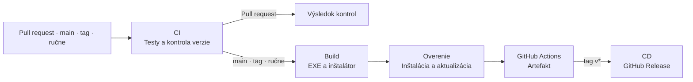

  
  <h1>Omni PDF</h1>
  
<strong>Jednoduché úpravy PDF priamo vo Windows.</strong>

  
Bez účtu · Lokálne spracovanie · Slovenčina a angličtina

  
  
<a href="https://github.com/hudakjakub/OmniPDF/releases/latest"><strong>Stiahnuť Omni PDF</strong></a>

## Čo dokáže

- Upraviť text, pridať textové pole alebo presunúť a odstrániť časť strany.
- Spojiť PDF, usporiadať strany a spracovať sken alebo fotografiu pomocou Windows OCR.
- Vytlačiť dokument a uložiť úpravy do novej PDF kópie.

## Začíname

Na stránke [vydaní](https://github.com/hudakjakub/OmniPDF/releases/latest) nájdeš inštalátor aj prenosnú verziu pre Windows x64. Aplikácia na úpravu dokumentov nepotrebuje účet ani internet; pripojenie používa pri kontrole a sťahovaní aktualizácií.

Aktuálne vydania nie sú digitálne podpísané, takže ich Windows môže upozornením alebo pravidlom zabezpečenia zablokovať.

[Používanie a obmedzenia](docs/pouzivanie.md) · [Vývoj a zostavenie](docs/vyvoj.md) · [História zmien](CHANGELOG.md)

## CI / CD

Každá zmena prechádza automatickými kontrolami. Po úspešnom zostavení vzniknú Windows balíky; release tag navyše zverejní vydanie na GitHube.

[Zobraziť workflow](https://github.com/hudakjakub/OmniPDF/actions/workflows/windows.yml) · [Ako funguje vydanie](docs/vyvoj.md#vývoj-a-vydávanie)

---

[GNU AGPL v3](LICENSE) · [Licencie závislostí](THIRD_PARTY_NOTICES.md)
