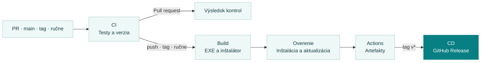

  
  <h1>Omni PDF</h1>
  
<strong>Upravuj PDF jednoducho, priamo vo Windows.</strong>

  
Bez účtu · Lokálne spracovanie · Slovenčina a angličtina

  

    
    
    
  

  
<strong><a href="https://github.com/hudakjakub/OmniPDF/releases/latest">Stiahnuť pre Windows ↓</a></strong> &nbsp; · &nbsp; <a href="docs/pouzivanie.md">Používanie</a> &nbsp; · &nbsp; <a href="docs/vyvoj.md">Vývoj</a>

   
  

## Jednoduchšie každodenné úpravy

- **Upravuj obsah** — prepíš text, pridaj vlastný alebo presuň či odstráň označenú oblasť.
- **Spravuj strany** — spoj dokumenty, vlož, duplikuj alebo odstráň strany.
- **Pracuj aj so skenmi** — otvor PDF, JPG či PNG a použi rozpoznávanie textu vo Windows.

Dokumenty zostávajú v počítači. Po úpravách ich môžeš vytlačiť alebo uložiť ako novú PDF kópiu.

## Stiahnutie

Na stránke [najnovšieho vydania](https://github.com/hudakjakub/OmniPDF/releases/latest) nájdeš inštalátor aj prenosnú verziu pre Windows x64. Aktualizáciu aplikácia ponúkne na potvrdenie.

> Aktuálne vydania nie sú digitálne podpísané. Windows preto môže aplikáciu alebo inštalátor zablokovať.

## CI / CD

Pull requesty, zmeny na `main` a release tagy prechádzajú kontrolami na Windows. Balíky sa po zostavení overia a release tag z nich vytvorí GitHub Release.

[Stav workflow](https://github.com/hudakjakub/OmniPDF/actions/workflows/windows.yml) · [Ako funguje vydávanie](docs/vyvoj.md#vývoj-a-vydávanie)

---

[Používanie a obmedzenia](docs/pouzivanie.md) · [Vývoj](docs/vyvoj.md) · [Zmeny](docs/CHANGELOG.md) · [Licencia AGPL v3](LICENSE)
